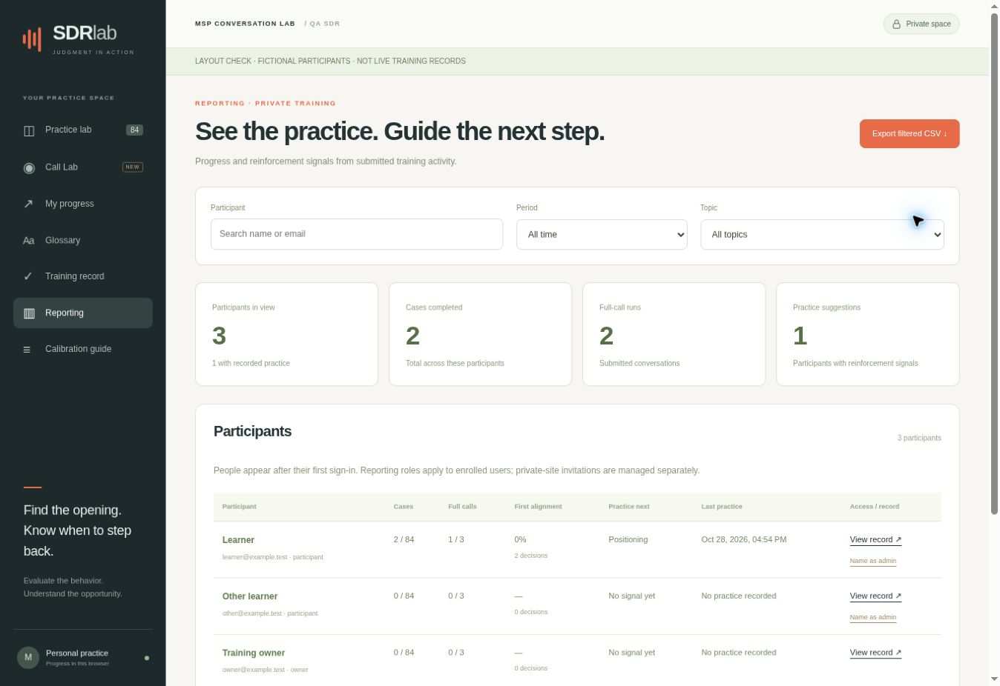
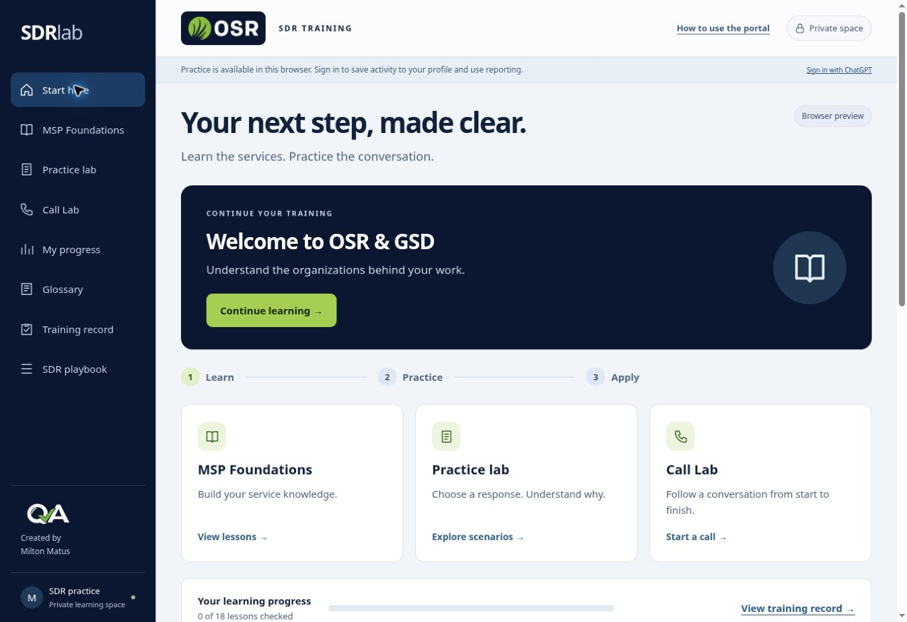
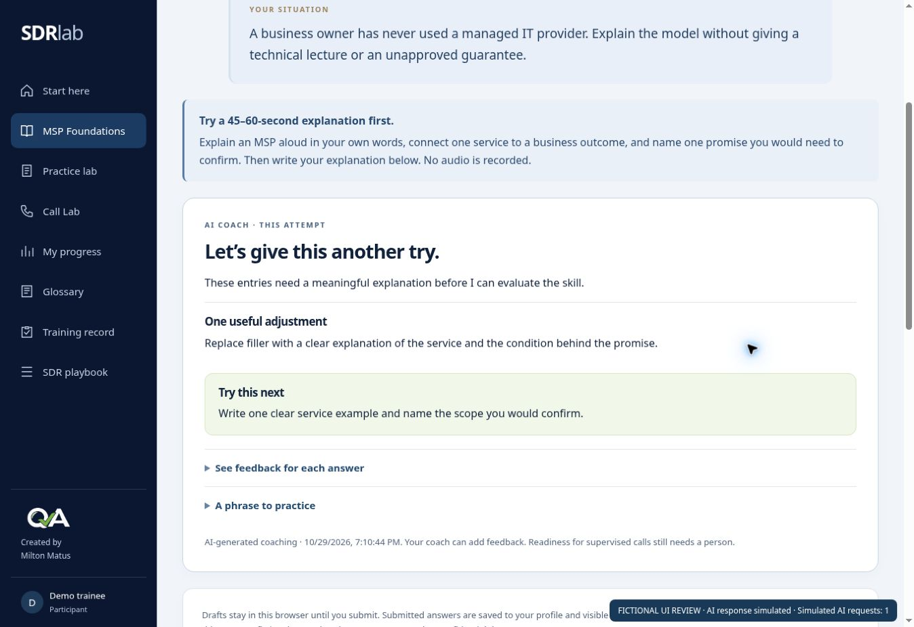
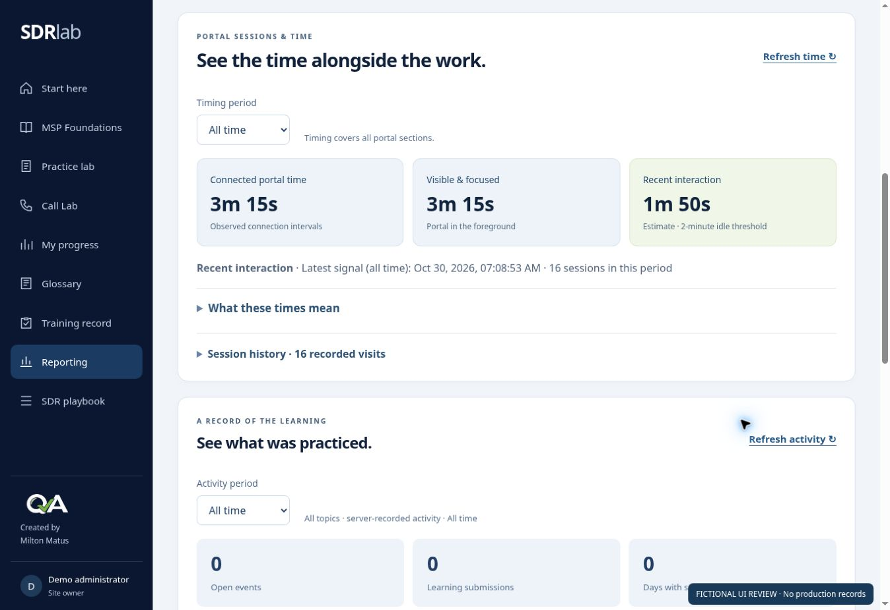

# SDR Lab — Judgment in action

Private English SDR onboarding and MSP conversation practice with authenticated profiles and administrator reporting.

## SDR onboarding

The default home is a guided, English SDR route: company orientation, MSP Foundations, conversation skills, applied practice, and readiness. Eighteen lessons include forty authored knowledge checks. Nine MSP lessons cover the business model, broad service portfolio, service delivery, devices/networks, cloud/Microsoft 365, backup/continuity, security, business value, and scoped assessments. Five written exercises cover explaining an MSP, discovery follow-ups, CRM handoff, the assigned client, and personal next-call judgment. There is no auditor course or QA-role worksheet.

Official OSR/GSD logo files are stored unchanged from their official websites. The original user-approved QA PNG is used as a discreet learning-design signature. The company relationship is owner-supplied. Company descriptions are linked to their official pages; actual client campaign commitments come only from the administrator-supplied brief.

Knowledge checks are scored server-side from canonical content; first and latest attempts stay separate. Viewing does not complete a lesson. Written answers are explicitly submitted to training administrators and receive automatic AI coaching when the secure AI connection is configured. Browser drafts are account-scoped and remain local until submitted. Unsigned previews can compare knowledge choices but do not submit a profile record.

Administrators can assign an enrolled participant's MSP brief and target date, read written evidence, answer and resolve help questions, and review readiness. All-time onboarding milestones appear alongside existing period/topic practice reporting and in CSV exports. No invitations or hosting-access changes occur through these actions.

Readiness requires all 18 checks aligned on their latest attempt, all 5 valid written submissions, at least six distinct main response cases, and one full Call Lab submission. This only permits human review; it does not auto-approve readiness. A training administrator may request targeted practice or approve supervised-call readiness. A changed brief invalidates its written submission and the old review; fresh evidence also makes a review stale. Due-date-only edits preserve the brief version. Status is not an employment decision, attendance measure, technical certification, or live-call performance result.

## Experience

The original 84-case bank, 75-term glossary, eight evolving moments, and three SDR-only full-call stories remain. Call Lab has 105 authored paths and behavior-based debriefs. No QA worksheet role has been reintroduced.

Signed-in users have a profile keyed to the Sites-verified stable user ID. Practice snapshots sync across devices. Account-scoped browser copies and queued submissions support retries. Earlier unscoped browser results require an explicit ownership confirmation before import; imports are marked. The earlier 18-case archive stays local and separate from expanded-bank metrics.

Training record provides a named screenshot/print summary: cases practiced, main-mode decisions submitted, full calls, initial and latest alignment, vocabulary references opened, topics, reinforcement suggestions, and recent evidence. Viewing does not count as completing practice.

Reporting administrators can search participants, filter by people role, period and topic, inspect individual records and coaching evidence, and export filtered CSV. Reinforcement uses the latest case attempts and latest full-call run per story. First attempts remain available as a learning baseline. No production QA rating, certification, attendance, or time-on-task claim is inferred.

## Roles and private access

- Participants read and update only their own practice and training record.
- Reporting administrators read/export training records. They cannot appoint administrators.
- The site owner can grant/revoke reporting access for already enrolled users; changes are audited. The owner role cannot be changed through the app.
- Reporting role changes do not invite anyone to the Site. Hosting remains owner-private until the owner explicitly authorizes a new audience or named visitors.

Sites owns authentication. API handlers use the official server helper and reject missing identity. They authorize every user-owned/admin operation server-side, validate same-origin mutations, and derive scores from canonical training content rather than client-supplied points. User IDs from request bodies cannot redirect ownership.

Configure TRAINING_OWNER_EMAIL as a runtime secret through Sites for initial owner identification. An optional TRAINING_ADMIN_EMAILS secret holds a JSON array of verified, owner-authorized administrator emails. On first authenticated enrollment, a matching account receives an audited, one-time application administrator grant. This does not grant hosting ownership or editing rights. Later owner revocations remain effective on subsequent sign-ins. No owner email, administrator email or credential is stored in source. Do not use the Sites account user ID as the Site-stable identity key.

## Storage and privacy

Cloudflare D1 stores profiles, private progress snapshots, submitted training events, administrator-role audit records, onboarding submissions, client assignments, and readiness reviews. Private Call Lab handoff notes belong to the user's snapshot and are excluded from administrator reports. Explicitly submitted onboarding explanations and help questions are stored separately for administrator review. There are no external analytics, microphone recordings, third-party trackers, or live prospect data.

Training source records remain anonymous reconstructed cases. No raw QA tracker, employee/customer identifiers, call links, or source recordings are embedded. No invented prices, free assessments, guaranteed savings, or universal service commitments are approved answers.

Resetting a practice view does not delete submitted reporting history. Event identifiers make retries/imports idempotent. Snapshot updates merge first decisions and current sessions with compare-and-swap retries. Historical imports do not replace recent live attempts. Date filters refer to server submission dates; imported results do not verify their original training dates.

## Source and build

- public/lab/ contains the retained interface, practice content, and reporting UI.
- app/route.ts serves the generated English shell at the original root URL.
- app/api/[...path]/route.ts uses Sites identity and delegates to lib/training-service.mjs.
- db/schema.ts and immutable drizzle/ migrations declare the D1 schema.
- scripts/sync-training-content.mjs creates canonical server JSON and the HTML shell before builds. Preserve the maintained Sites/Vinext/Cloudflare integration.

Build with the Sites build helper. Source manifest retains the same project ID, declares D1 as DB, and no longer declares a static-only deployment. Keep local environment, runtime caches, test output, and build output untracked.

## Verification

node scripts/test-onboarding.mjs validates all 18 lessons and 40 checks and runs SQLite-backed integration tests for course scoring, owner/admin boundaries, explicit written submissions, brief versioning, help responses, deadlines, readiness gating, and stale-review protection.

node scripts/validate.mjs checks all 84 cases and 75 glossary terms. node scripts/validate-call-lab.mjs checks all 105 authored call paths. node scripts/test-training.mjs runs real SQLite-backed API tests for anonymous rejection, participant isolation, owner/admin grants and revocation, CSRF, server-derived scoring, idempotency, topic/date filters, private notes, snapshot ownership and reset behavior, and historical-import handling.

Browser verification covers preserved practice loading, signed-out reporting denial, reporting layout and search with explicitly fictional fixtures, CSV download/content, participant summaries, improvement indicators, administrator-permission confirmation, and mobile layout at 390px without page overflow. Visual fixtures are removed before packaging; production contains no demo participants. Production ChatGPT sign-in is platform-owned and remains gated.

## Onboarding browser validation

The final onboarding route, official marks, lesson selection, wrong/right explanations, administrator record navigation, disabled readiness approval when the brief is stale, save-error preservation, mobile layout, and account-scoped written-draft retention were inspected in the browser. Administrator layout data was explicitly fictional and read-only; fixtures were removed before packaging. At a 390px frame, document width and content width were both 375px (remaining space is the frame scrollbar). No live participants were seeded or impersonated. Platform-owned production sign-in was not bypassed.

## Guided learning and visual refresh

The navy/lime design keeps one primary action on the learner home. Lessons separate Learn, See an example, and Try it yourself, with one knowledge decision visible at a time. Required checks, five written submissions, six distinct main response cases, one full call and human readiness review remain unchanged. The diagnostic is advisory; it never waives orientation or required evidence.

- Eight starting-point questions distinguish MSP knowledge from conversation judgment.
- Six interactive service-map entries connect services, business outcomes, discovery questions and visible scope boundaries.
- Nine contextual decisions across email, contracts and internal IT teach how evidence changes the appropriate next step. Targeted case bundles follow worked examples; the worked case is omitted from its lesson's independent bundle.
- An optional 45–60-second spoken teachback links to the existing written MSP explanation. Audio is not recorded.
- Submitted diagnostics and context attempts retain first/latest evidence in D1. Recommendations prioritize mismatched checks, context decisions, diagnostic gaps and recall after seven days. New supplemental evidence makes earlier readiness reviews stale; users without new supplemental activity retain their existing review fingerprint.
- Administrator onboarding separates knowledge, written work, account plan and readiness, with shortcuts and submitted supplemental evidence. CSV includes the new all-time diagnostic/context fields and the recommended next topic.
- A four-step, replayable portal walkthrough is available in the header.

public/lab/learning-path-data.js is authored learning content. lib/learning-service.mjs computes canonical results and recommendations from generated JSON. The new activity kinds reuse the existing onboarding entries table; this release requires no database migration. node scripts/test-learning-path.mjs covers content integrity, canonical scoring, ownership, idempotency, unchanged readiness gates, stale reviews and spaced-practice timing.

The visual refresh was checked in a desktop browser and a 390px mobile frame. Profile/role integration was checked with SQLite-backed API tests and clearly labeled fictional local UI fixtures; no production records were seeded and the hosting audience was preserved.

## Supportive coaching and learning evidence

Practice feedback uses “Nicely done,” “Almost there” or “Let’s work through this one,” followed by the observable strength where supported, the specific reasoning, a useful next attempt and the service/contact boundary. Canonical scores remain unchanged. Written work and submitted checks use the server-side AI review integration described below. Runtime connection state is shown explicitly; no AI feedback is fabricated when the connection is absent or failing.

Administrators can give each latest written submission structured feedback: what the trainee handled well, one useful adjustment and a next step. A focused revision blocks readiness approval until a new answer is submitted; the new answer makes previous exercise feedback stale and requires a fresh human review. Exercise feedback is append-only, linked to the exact submitted answer, and included in the learner’s own record.

The individual activity timeline combines canonical case decisions, completed call paths, opened references/lessons, lesson checks, written submissions, diagnostic/context practice, questions, coaching and the latest recorded readiness review. Collapsed evidence and five-record pagination keep it readable. It excludes private Call Lab notes. Cohort reporting defaults to SDRs and separates open events, learning submissions and distinct Managua calendar days with submitted work. Browser imports are labeled and excluded from these submission/day counts. These are learning artifacts, not proof of attendance or continuous activity. The filtered CSV has 39 columns and retains the selected people, period and practice-topic context; activity evidence explicitly covers all topics.

node scripts/test-accountability.mjs checks configured administrator enrollment and revocation, ownership isolation, evidence counts, timeline pagination/filtering, import separation and calendar-day boundaries. Exercise-feedback authorization, exact-submission matching and readiness/revision behavior are included in test-onboarding.mjs. Browser validation uses read-only fictional local records and confirms the cohort role filter, 39-column CSV, evidence expansion/pagination, review-form error preservation, friendly partial feedback and 390px layout. Test fixtures are removed before packaging.

## AI coaching integration

Every newly submitted written exercise, lesson check, diagnostic, context choice, main-case choice and complete call triggers an automatic attempt-specific AI review. Reopening saved written exercises/checks retrieves or generates the review. Each response includes an overall developmental status, grounded strengths, one or two focused adjustments, per-answer feedback, a next action and an illustrative phrase. The reference answers and their canonical points remain authoritative. Private optional Call Lab notes remain private and are not sent for AI review; the explicitly submitted CRM handoff exercise is reviewed.

The Worker calls the OpenAI Responses API with structured output, no tools, `store:false`, a 35-second timeout and a bounded output budget. Default model: `gpt-5.4-mini-2026-03-17`; a trusted runtime `TRAINING_AI_MODEL` may override it. `OPENAI_API_KEY` must be provisioned through the OpenAI Developers plugin and stored only as a Sites runtime secret. No key is present in source or client code. `GET /api/session` exposes only whether the connection has been configured. An absent key, provider failure, malformed/refused output or timeout never produces a successful AI-review badge.

The additive 0002 migration stores review records keyed by the authenticated user, source stream, immutable event ID and curriculum/account-context hash. Cached results and transactional conditional claims avoid duplicate model calls. Failed retries wait 30 seconds; stale claims expire after 90 seconds. Bounded guards allow at most eight recent attempt units, 120 daily attempt units per user, and 1,000 for the Site, counted conservatively across retries. These application guards complement the owner's API project budget. Exact learner quotes are validated before praise is shown. Filler receives a rewrite request, and the AI cannot upgrade a mismatched canonical check.

With AI enabled, written work awaiting feedback or requiring revision cannot pass the readiness gate. A current human exercise review can resolve the item. Final readiness always requires a person. New AI evidence invalidates an older readiness review. Administrators can open saved AI feedback alongside each written exercise/check and through the activity timeline. Their first view retrieves cached feedback; generating a missing review for a participant requires an explicit click.

`node scripts/test-ai-review.mjs` covers all submission families, auth, ownership, source validation, caching, concurrency, provider response structure, exact strength evidence, canonical scores, filler revision state, changed briefs, privacy, errors, retry cooldowns and usage guards. These tests use simulated provider responses; a real end-to-end AI review must be verified after connecting the runtime credential.

Browser QA confirmed that reopening an exercise and submitting updated written work each trigger a single simulated review, lesson checks trigger review after the complete submission, and per-answer feedback expands separately. A 390px frame has matching 375px content and viewport widths. No production learner records were seeded. The image below is a labeled UI test with a simulated response, not proof of a connected model.

## Portal session timing

Authenticated portal visits now send a timing signal normally every 30 seconds. Reporting adds connected portal time, visible/focused time, an estimate of recent interaction, first/last session signals, current presence and the last portal section. The interaction estimate stops after two minutes without input; reading can continue without input. Participants see a timing notice and can inspect their own record. Administrators can inspect other enrolled profiles. This feature does not require or call the AI provider.

The additive 0003 migration creates portal-session records and per-second masks within 30-second buckets. Only server receipt time bounds intervals, and delayed signals add at most 45 seconds. Conditional claims and monotonically increasing sequence numbers make duplicate/out-of-order packets idempotent. Participant totals use union masks across tabs/devices; individual session rows may overlap. Generated stored counts make period aggregates compact. Timing does not add lesson completions, learning submissions, practice days, readiness points or attendance ratings. No input text, key values, coordinates or activity outside the portal is captured by this timer.

A new page load creates an observed portal visit. Sign-out/page-exit signals close it when received; after 90 seconds without a signal an open visit shows No recent signal. The last signal is not a guaranteed logout time. Browser suspension and network loss can leave unobserved gaps. Dates use Nicaragua time. Measurements begin with this release and cannot reconstruct earlier login durations. Current presence and latest signal are labeled separately from period totals. The filtered 39-column cohort CSV includes six timing fields; the individual record offers all-time/7-day/30-day summaries and paginated session history.

`node scripts/test-presence.mjs` covers authentication, role/CSRF boundaries, no backdating, idle/visibility distinctions, server bounds, concurrent/duplicate signals, closed visits, multi-tab union, period clipping, Nicaragua midnight, pagination and unchanged learning counts. It also executes the actual browser tracker in a controlled browser-event/clock harness to check hidden/idle signals and that no key/input values are captured. Browser QA with explicitly fictional local data checked cohort timing, the 39-column CSV, individual history pagination, period selection and a 390px frame without document overflow. Fixtures are removed before publication.

